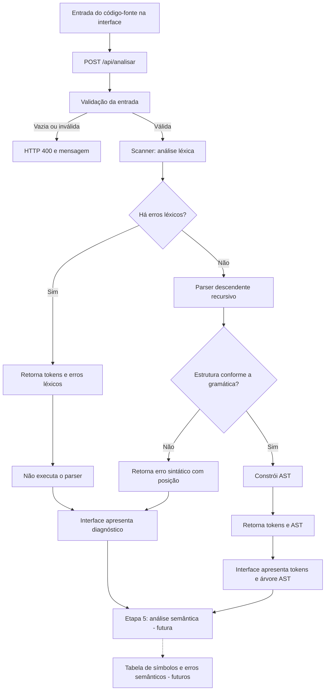

# Fluxograma da análise do código-fonte

O fluxograma representa o comportamento implementado nesta etapa. A análise semântica e a tabela de símbolos aparecem como atividades futuras, não executadas.

## Estado das etapas

| Componente | Estado nesta versão |
| --- | --- |
| Entrada e validação | Implementado |
| Análise léxica | Implementado |
| Decisão de bloquear parser diante de erros léxicos | Implementado |
| Análise sintática | Implementado |
| Construção da AST | Implementado |
| Apresentação da AST na interface | Implementado |
| Análise semântica | Pendente — próxima etapa |
| Tabela de símbolos | Pendente — próxima etapa |

## Contrato resumido entre frontend e backend

A interface envia `POST /api/analisar` com `{ "codigo": "..." }`. O backend retorna `sucesso`, `message`, `tokens`, `erros`, `lexico` e `sintatico`. Os erros léxicos ficam em `erros`; os sintáticos em `sintatico.erros`. O campo `sintatico.executada` informa se o parser foi chamado. Quando executado com sucesso, `sintatico.ast` contém a árvore; diante de erro sintático, a AST é nula.
